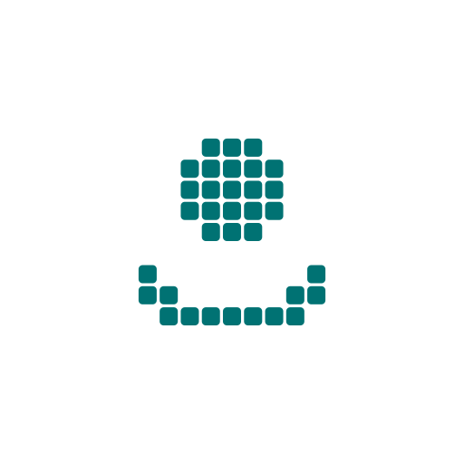
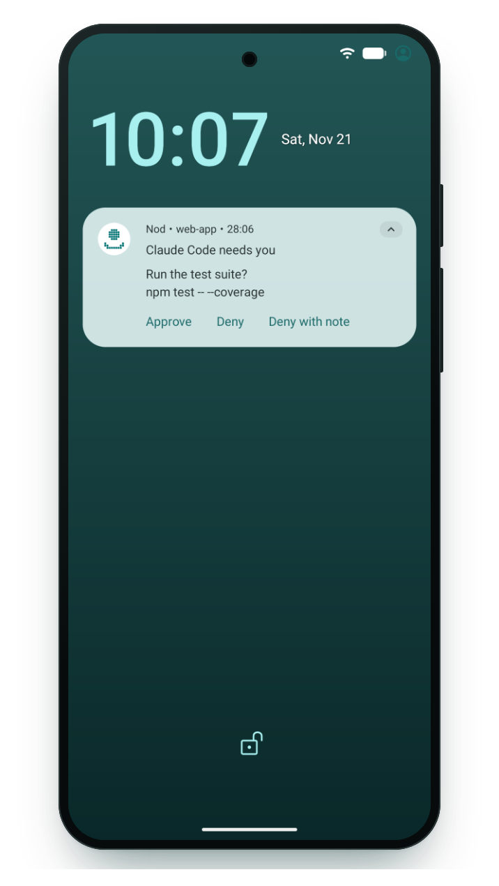
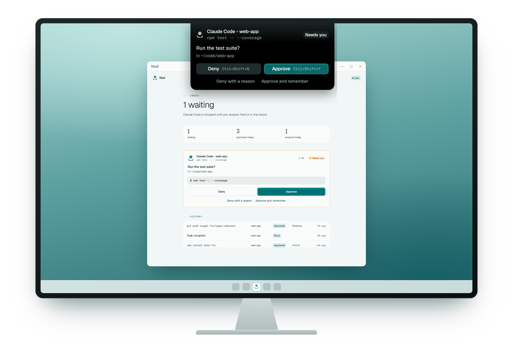
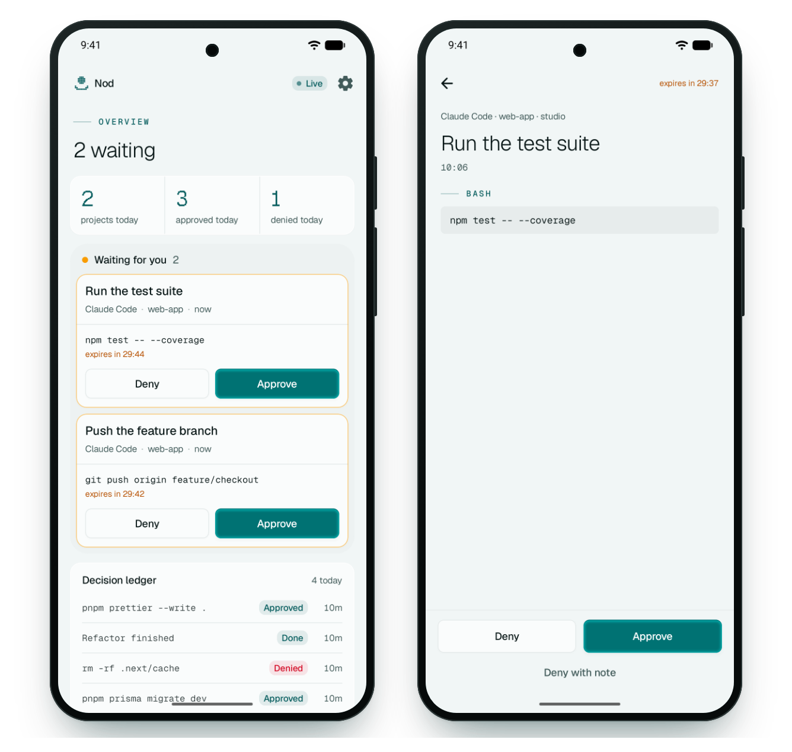
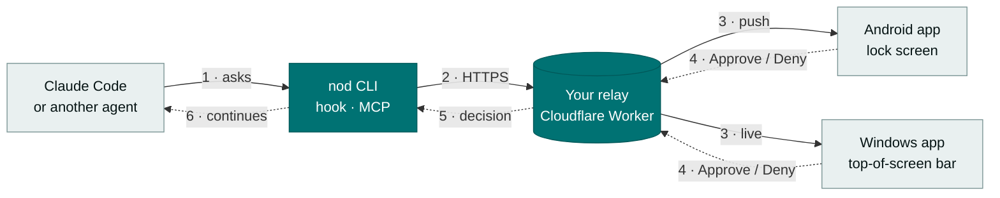

<p align="center"></p>

<h1 align="center">Nod</h1>

<p align="center"><b>Answer Claude Code from your phone and your desktop.</b><br>
Approve commands, answer questions, review plans and see when a task is done,<br>
without sitting in front of the terminal. Self-hosted, free, open source.</p>

<p align="center">
  <a href="https://github.com/NilsMorczinietz/nod/actions/workflows/ci.yml"></a>
  <a href="https://github.com/NilsMorczinietz/nod/releases/latest"></a>
  <a href="LICENSE"></a>
</p>

<p align="center">
  <a href="https://github.com/NilsMorczinietz/nod/releases/latest">Download</a> ·
  <a href="docs/setup.md">Setup guide</a> ·
  <a href="docs/development.md">Development</a>
</p>

<p align="center">
  
  &nbsp;
  
</p>

## What it does

| When Claude Code…                     | Nod…                                                                   |
| ------------------------------------- | ---------------------------------------------------------------------- |
| wants to run a command or edit a file | asks you: **Approve · Deny · Deny with note**, even on the lock screen |
| asks you a question                   | shows the options; tap one                                             |
| has a plan ready                      | lets you approve it or send feedback                                   |
| finishes a longer task                | tells you it's done, with a short summary                              |

- **Android app** with actionable notifications.
- **Windows app**: a small bar at the top of the screen, like a notch, with keyboard shortcuts.
- **Phone stays quiet while you're at your PC** (mode "When I'm away"), and takes over when you leave.
- **Not only Claude Code:** an MCP server for Cursor, Claude Desktop, Codex & co., and `nod ask`
  for scripts and CI. See [integrations](docs/integrations.md).
- **Safe by default.** If nobody answers, or anything is offline, Claude Code simply asks in the
  terminal as usual.

## The apps

<p align="center"></p>

The phone shows what is waiting, what happened today and every past decision. The Windows app
puts the same requests in a small bar at the top of your screen, with **Ctrl+Shift+Y / N** to
approve or deny without leaving your editor.

## Quick start

You need: [Node.js](https://nodejs.org) 22+, [Claude Code](https://code.claude.com), and a free
[Cloudflare](https://dash.cloudflare.com/sign-up) account.

```bash
git clone https://github.com/NilsMorczinietz/nod.git
cd nod
npm install
npm run setup        # deploys your relay, installs the CLI and the Claude Code hooks
```

Then install the apps from the [latest release](https://github.com/NilsMorczinietz/nod/releases/latest),
run `nod pair`, and scan the QR code. **[Full setup guide →](docs/setup.md)**

## How it works



1. Claude Code wants to run a command and calls `nod` through a
   [hook](https://code.claude.com/docs/en/hooks).
2. `nod` sends the request to **your own relay** and waits.
3. The relay pushes it to your phone and shows it on your PC at the same time.
4. You answer on either one. The first answer wins, and the other device updates.
5. The relay hands the decision back to `nod`.
6. Claude Code continues, or asks in the terminal if nobody answered.

More: [architecture](docs/architecture.md) · [protocol](docs/protocol.md) ·
[integrations](docs/integrations.md) · [design](docs/design.md)

## Staying up to date

- **CLI:** `nod update`
- **Apps:** they check for new releases themselves (Settings › About).
- **Relay:** `git pull && npm install && npm run deploy -w @nod/relay`

See [setup › Updating](docs/setup.md#updating).

## Security

The relay runs in your Cloudflare account; nothing passes through third-party servers except
Google's push service. Device tokens are random, stored only as hashes, and can be revoked at any
time (`nod revoke`). If you prefer, "Approve" from the lock screen can require unlocking the phone and
the command can be hidden there (both are app settings). Details:
[architecture › Security](docs/architecture.md#security-model). Report vulnerabilities privately,
see [SECURITY.md](SECURITY.md).

## Contributing

Issues and pull requests are welcome; start with [CONTRIBUTING.md](CONTRIBUTING.md).

## License

[MIT](LICENSE). Nod is an independent project and is not affiliated with or endorsed by Anthropic.
"Claude" and "Claude Code" are trademarks of Anthropic.
