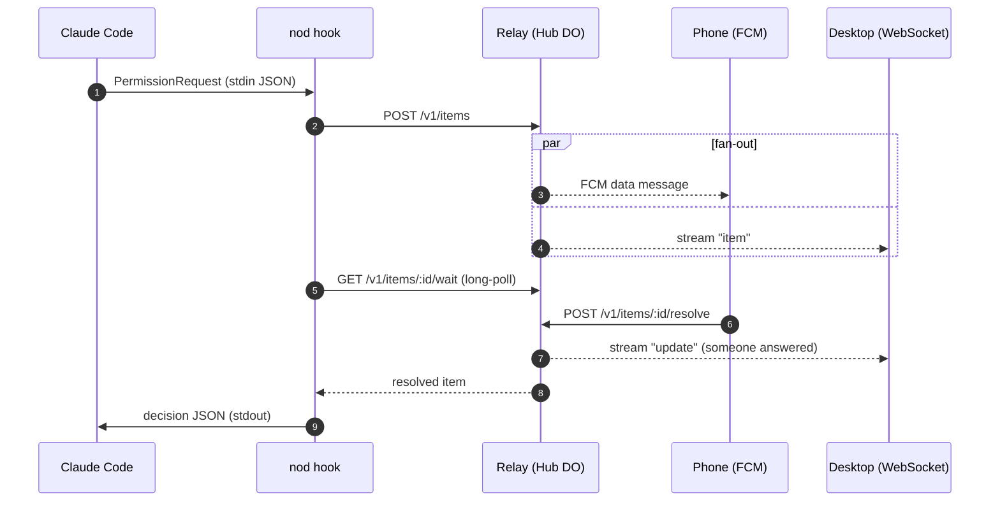

# Architecture

Nod connects Claude Code (running on your PC or in WSL) to your phone and desktop
so you can approve tool calls, answer questions and review plans from anywhere,
and get a notification when a task is done.

## Components

| Part                 | Tech                                                 | Responsibility                                             |
| -------------------- | ---------------------------------------------------- | ---------------------------------------------------------- |
| `cli/`               | Node ≥ 22, TypeScript, bundled to one file           | Claude Code hook bridge, setup, pairing, device management |
| `relay/`             | Cloudflare Worker + one SQLite-backed Durable Object | State, auth, fan-out, expiry, push via FCM HTTP v1         |
| `android/`           | Kotlin, Jetpack Compose, Material 3                  | Lock-screen actions, inbox, detail screens, animations     |
| `desktop/`           | Tauri 2 (Rust) + Svelte 5                            | Tray app, always-on-top overlay cards, inbox               |
| `packages/protocol/` | TypeScript types                                     | The wire contract (mirrored by hand in Kotlin and Rust)    |

## Flow of a permission request

1. Claude Code wants to run `rm -rf build` and fires the `PermissionRequest` hook.
2. `nod hook` reads the event from stdin, turns it into an item (`kind: "permission"`)
   and `POST /v1/items` to the relay.
3. The Hub stores it, broadcasts it to connected desktop WebSockets and sends a
   high-priority FCM data message to every paired phone.
4. The hook long-polls `GET /v1/items/:id/wait` (25 s per request, re-polls).
5. The first device to `POST /v1/items/:id/resolve` wins. The Hub wakes the
   waiting poll, tells all other clients (`update` message, FCM `dismiss`) and
   returns `409` to anyone answering later.
6. The hook prints the decision JSON; Claude Code continues.

## Reliability rules

- **Fail open to the terminal.** Any error, a missing config, the relay being
  down, nobody paired, the hub being paused, or no answer before the TTL: the hook
  exits `0` without output and Claude Code shows its normal terminal prompt.
- **No orphans.** If the hook is killed (Ctrl+C, timeout) it cancels the item.
  If it dies hard, the Hub notices the missing polls within ~75 s and cancels it,
  so stale notifications disappear from the phone.
- **Hibernation.** Desktop clients use the WebSocket Hibernation API with an
  auto-response for `ping`, so idle connections cost nothing.
- **Single writer.** One Durable Object owns all state. That alone gives
  "first answer wins" without locks.

## Security model

- The relay is yours: deployed to your own Cloudflare account, HTTPS only.
- **Admin token** (Worker secret `ADMIN_TOKEN`): held by the machines running
  Claude Code. It can create items and pair devices.
- **Device tokens**: 256-bit random, issued once during pairing, stored only as
  SHA-256 hashes on the relay. Only device tokens can resolve requests.
  Revoke any device with `nod revoke <id>`.
- **Pairing codes**: one-time, 10 minutes, hashed at rest; ten wrong attempts
  invalidate all open codes.
- **Phone**: the token is encrypted with an Android Keystore key. Requests show on the lock
  screen with Approve / Deny so you can answer without unlocking; two settings tighten this
  ("Require unlock to approve", and hiding the command on the lock screen). Deny always works.
- **Desktop**: the token lives in Windows Credential Manager.
- Items are kept 7 days (max 300) and contain only short previews of tool input.

## Cost

Everything fits the free tiers for a single user:

- Cloudflare Workers Free: 100k requests/day; SQLite Durable Objects are on the
  free plan. Hibernated WebSockets are not billed while idle.
- Firebase Cloud Messaging: free.
- No iOS (would need the Apple Developer Program).
